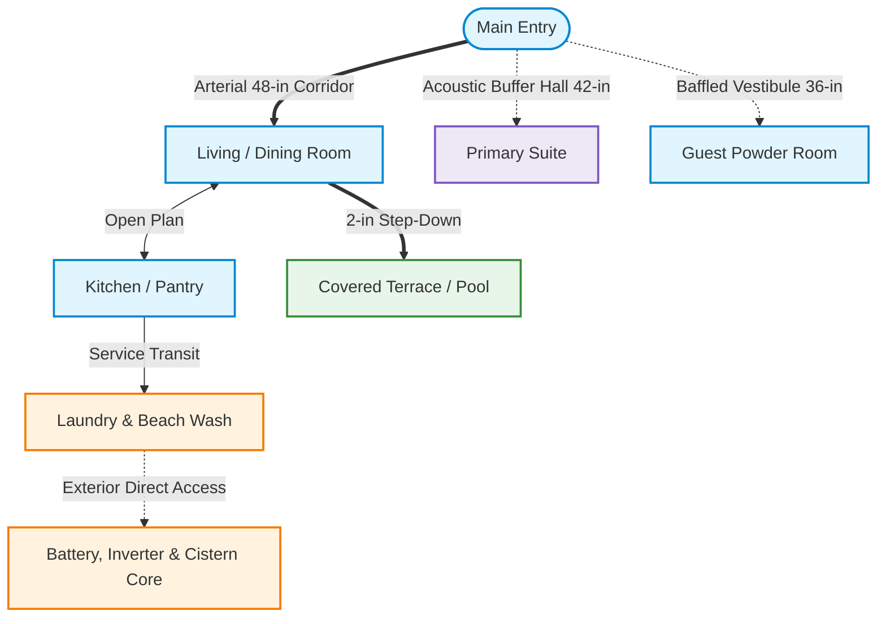

# CAD Floorplan Designer

Design buildable, structurally sound 2D architectural floor plans, spatial circulation flows, and utility infrastructure layouts adhering to modular construction, zoning setbacks, and spatial UX standards.

---

## Bundled Tools & References

- **Supporting Scripts**:
  - `python3 cad-floorplan-designer/scripts/validate_cmu_grid.py --check-spans "24' 8\"" "16' 0\""`: Validates dimensions against 8" and 16" CMU modular units.
  - `python3 cad-floorplan-designer/scripts/validate_cmu_grid.py --site-envelope --lot-width "60' 0\"" --lot-depth "100' 0\"" --side-setback "10' 0\""`: Computes setback envelope snapped to modular increments.
  - `python3 cad-floorplan-designer/scripts/audit_spatial_ux.py --demo --mermaid`: Audits clearances, door collisions, acoustic buffers, and generates Mermaid circulation graphs.
  - `python3 cad-floorplan-designer/scripts/render_floorplan_svg.py --demo -o plan.svg`: Renders 2D CAD SVG floorplans with alphanumeric grid lines and circulation path overlays.
- **Deep-Dive References**:
  - [CMU Modular Masonry Guide](references/cmu-masonry-guide.md): Standard block dimensions, courses, lintel spans, and bond beams.
  - [Spatial UX & Circulation Design Guide](references/spatial-ux-and-circulation.md): Clear widths, door ergonomics, acoustic buffering, and sightline privacy.

---

## Core Design Principles

1. **Modular Grid Discipline**: All structural spans, exterior footprints, and major room bays must align strictly to construction units (for CMU masonry: **8-inch and 16-inch increments**) to eliminate cutting blocks in the field.
2. **Buildable Envelope First**: Calculate property boundaries minus mandatory zoning setbacks (*retranqueos* for front, rear, and sides) and topography buffers before placing walls.
3. **Spatial UX & Circulation Hierarchy**:
   - **Arterial Spines (High Traffic)**: 42"–48" clear corridors connecting primary public spaces (Entry $\leftrightarrow$ Kitchen $\leftrightarrow$ Living $\leftrightarrow$ Terraces).
   - **Secondary Corridors (Medium Traffic)**: Minimum 36" clear paths for private sleeping and bathroom access.
   - **Service Paths (Low Traffic)**: Dedicated routes for utility maintenance (cistern, battery room, laundry) kept separate from guest sightlines.
   - **Acoustic & Visual Zoning**: Decouple entertaining spaces and mechanical hum (pumps, inverters) from bedroom headboards via buffer zones (closets, hallways, masonry shear walls).
4. **Envelope & Microclimate Defense**: Shield weather-exposed flanks with solid shear walls; provide deep covered overhangs (3'–4') and 1.5"–2" threshold step-downs for wind-driven rain defense.
5. **Vertical Stacking & Utility Resilience**: Stack vertical circulation and wet walls. Dedicate fire-rated, ventilated mechanical rooms for solar inverters, battery storage, cisterns, and ATS.

---

## Workflow Steps

### Step 1: Project Intake & Calibration
- **User Intake Check**: If the user has not provided a project name or description, **prompt the user using `ask_user` (or `ask_question`)** to supply a project name and a brief summary of site conditions, program goals, or target style before generating the layout.
- Define lot dimensions and mandatory setbacks (*retranqueos* for front, rear, and side boundaries).
- Account for natural slope, slope direction, and high-erosion buffers (e.g., cliff edges).
- Compute the maximum allowable footprint and snap the outer dimensions inward to the nearest structural modular increment (8" or 16" for CMU) using `validate_cmu_grid.py`.

### Step 2: Spatial UX Program & Circulation Topology
Before drawing walls, map functional adjacencies, acoustic buffers, and traffic volume. Output a **Mermaid Circulation Graph**:

### Step 3: Spatial UX & Ergonomics Verification
Audit layout against high-traffic failure modes:
- **Door Clearance**: Swing doors into rooms against adjacent walls; never swing directly into arterial circulation paths or collide with opposing doors.
- **Transit Efficiency**: Short, direct path from parking/entry to pantry for supplies ($\le 2$ hops); wet-to-dry transit from beach/pool to laundry/outdoor shower without crossing carpeted or primary living areas.
- **Sightline Privacy**: Avoid direct sightlines from public entry doors or dining tables into private bedrooms or powder room toilets.
- **Life Safety & Egress**: Verify 36" clear egress paths to exterior exits; ensure sleeping rooms have at least one emergency egress window ($\ge 5.7\text{ sq ft}$ clear opening).

### Step 4: Structural and Masonry Layout
- **Exterior Walls**: Draw exterior walls and primary lateral shear walls at full structural thickness (8" CMU). Reinforce flank walls with minimal punched openings where lateral wind loads or solar heat gains are extreme.
- **Interior Partitions**: Specify standard interior partitions at 4" to 6".
- **Slope Adaptation**: Differentiate between upslope retaining walls (thick reinforced concrete) and downslope walk-out curtain walls. Mark Finished Floor Levels (FFL) for each zone and incorporate step-downs (1.5" to 2") at outdoor terrace thresholds.
- **Wet Wall Consolidation**: Back-to-back bathrooms and vertically stacked plumbing chases to minimize pipe runs and acoustic noise.

### Step 5: Island Resilience Core Integration
Incorporate dedicated spaces for utility independence:
- **Service Entrance**: Place electrical meter base and automatic transfer switch (ATS) along the street-facing access facade.
- **Battery & Power Room**: Design a dedicated, ventilated, fire-rated space for solar inverters, lithium batteries, and generator tie-ins.
- **Water Security**: Designate a footprint for a domestic cistern (600 to 1,200 gallons) and automated booster pump station isolated on vibration dampeners.
- **Waste & Drainage**: Align main sewer exits toward down-gradient terrain reserved for septic and percolation fields. Add perimeter interceptor drains along upslope foundations.

### Step 6: Generate Visual 2D CAD Plan (SVG)
Output a standalone, clean, responsive SVG code block for each floor level:

- **ViewBox & Theme**: Use `viewBox="0 0 1400 900"` with dark CAD styling (`#0b1120` or `#0f172a` background, white/cyan lines) or blueprint styling.
- **SVG Layer Structure**:
  - `<g id="structural-grid">`: Dashed grid lines (`#334155`) with alphanumeric grid bubbles (`A, B, C...` and `1, 2, 3...`) at perimeter.
  - `<g id="structural-walls">`: Heavy filled geometry (`#1e293b` fill, `#38bdf8` stroke) for 8" CMU exterior walls.
  - `<g id="partitions">`: Medium stroke lines (`#94a3b8`) for interior walls.
  - `<g id="doors">`: 90-degree SVG path arcs (`A` command) for door swings; door frames.
  - `<g id="windows">`: Double-line tracks or recessed openings within wall boundaries.
  - `<g id="circulation-paths">`: Dashed overlay paths showing primary traffic arteries in amber (`#f59e0b`) and secondary in cyan (`#06b6d4`).
  - `<g id="labels">`: Non-overlapping room titles, clear dimensions (feet and inches), and FFL callouts.
  - `<g id="symbols">`: Architectural North arrow and stair direction indicators.

### Step 7: Architectural and Resilience Schedule
Accompany the SVG drawing with a comprehensive technical matrix:
- **Room Dimension Schedule**: Room name, clear interior dimensions ($L \times W$), net area in square feet and square meters, and traffic tier.
- **Zoning and Coverage Matrix**: Gross building area, ground coverage ratio, and setback compliance verification.
- **Corner Staking Table**: Primary structural grid intersection points (e.g., Grid A-1, A-5, D-1, D-5) with offset distances from boundary pins to guide geotechnical soil borings and percolation tests.
- **Resilience Core Specifications**: Wall schedule (CMU 8", partition 4"/6"), cistern capacity (gal), battery backup (kWh), and drainage step-down details.

---

## Gotchas & Edge Cases

- **Non-Modular Dimensions**: Any exterior wall dimension not divisible by 8" or 16" breaks masonry layout and causes costly block-cutting in the field.
- **Corridor Bottlenecks**: Corridors narrower than 36" (or 42" near kitchen island prep zones) cause severe bottlenecking during multi-occupant use.
- **Flush Weather Thresholds**: Placing exterior sliding doors flush with indoor FFL without a 1.5"–2" drop and covered overhang guarantees wind-driven water penetration during heavy storms.
- **Door-to-Door Collisions**: Powder room or closet doors swinging into adjacent room entry paths create impact hazards and pinch points.
- **Unbuffered Plumbing Chases**: Running main vertical waste stacks inside bedroom headboard walls creates acoustic disturbance; isolate within furred shafts or utility walls.
- **SVG Text Overlap**: Never position room labels or dimensions directly over wall strokes or door swing arcs. Use distinct vertical/horizontal label anchors (`text-anchor="middle"`).
