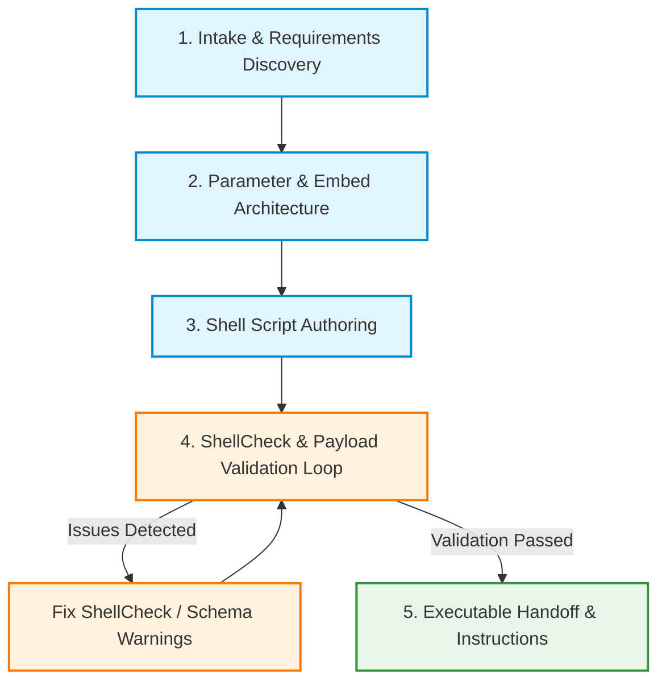

# Discord Webhook Script Writer

Interactively design, parameterize, and generate production-ready Bash scripts that deliver formatted Discord messages, rich embeds, and file attachments using `curl` and `jq`. Every script is verified with ShellCheck and validated against Discord's API schema before handoff.

---

## Bundled Tools & References

- **Supporting Scripts**:
  - `python3 discord-webhook-script-writer/scripts/validate_script.py <script.sh>`: Runs static analysis, ShellCheck linting, dry-run execution, and Discord webhook payload JSON schema validation.
  - `python3 discord-webhook-script-writer/scripts/validate_script.py <script.sh> --sample-args "--title Test --status success"`: Tests dry-run execution with sample arguments.
  - `python3 discord-webhook-script-writer/scripts/validate_script.py <script.sh> --json`: Emits validation diagnostics in structured JSON.
- **Deep-Dive References**:
  - [Discord Webhook API & curl Reference](references/discord-api-reference.md): Payload schemas, embed field constraints, decimal colors, mentions, rate limits, and multipart upload specs.
  - [Bash Scripting Standard](references/bash-scripting-standard.md): Mandatory shell safety conventions (`set -euo pipefail`, `IFS=$'\n\t'`), dual-source webhook resolution, `jq` payload construction, and retry patterns.
  - [Production Script Templates Catalog](references/script-templates.md): Index and selection guide for modular templates (CI/CD, cron monitoring, backups, file uploads).
    - [CI/CD Deployment Notifier](references/templates/ci-cd-deploy-notify.md)
    - [Cron Server Resource Monitor](references/templates/cron-server-monitor.md)
    - [Automated Backup Notifier](references/templates/cron-backup-notify.md)
    - [File Attachment & Log Uploader](references/templates/file-uploader-notify.md)
    - [Generic Parameterized Alert](references/templates/generic-embed-alert.md)

---

## Architectural & Safety Principles

1. **Dual Webhook URL Resolution**: Never force the user into an either/or choice between CLI flags and environment variables. All generated scripts must check the CLI flag (e.g. `-w` / `--webhook-url`) first, fall back to the `DISCORD_WEBHOOK_URL` environment variable, and fail with a clear message to `>&2` if neither is provided.
2. **Safe JSON Construction via `jq`**: Never use raw bash string interpolation to construct JSON. Dynamic strings with quotes, newlines, or backslashes break naive string concatenation. Use `jq -n --arg ... --argjson ...` to guarantee valid, injection-safe JSON.
3. **ShellCheck Cleanliness**: Every generated script must pass `shellcheck -s bash` with zero errors and zero warnings.
4. **Resilient HTTP & Rate Limits**: Discord returns `204 No Content` on success. Capture HTTP status codes via `curl -sS -w "%{http_code}"` and implement backoff handling for `429 Too Many Requests` (respecting `retry_after`) and `5xx` server errors.
5. **Preview via Dry Run**: Every generated script must provide `--dry-run` to output the formatted JSON payload and webhook destination without sending network requests.

---

## Workflow: From User Request to Production Script



---

## Step-by-Step Procedure

### Step 1: Intake & Requirements Discovery

When the user requests a Discord bash script, evaluate what information is provided and interactively confirm any missing specifications:

- [ ] **Target Use Case**: Cron job (backup, uptime, resource alert), CI/CD runner (GitHub Actions, GitLab CI), deploy hook, or manual CLI tool?
- [ ] **Notification Style**: Plain text message, rich embed, or multipart file attachment (e.g., build log)?
- [ ] **Dynamic Parameters**: Which values must be passed as CLI arguments? (e.g., `--status`, `--message`, `--repo`, `--duration`, `--log-file`)
- [ ] **Status / Visual Cues**: Does the embed require dynamic color states? (e.g., Green for Success, Red for Error, Yellow for In-Progress)
- [ ] **Pings / Mentions**: Does the script need to mention specific Discord users or roles (`<@USER_ID>`, `<@&ROLE_ID>`) on failure?
- [ ] **Silent Mode**: Should routine notifications be delivered silently (`flags: 4096`) to prevent notification fatigue?

> [!NOTE]
> If key parameters (e.g. embed fields, alert thresholds, or CLI arguments) are omitted, ask clarifying questions before generating the script.

---

### Step 2: Parameter & Embed Architecture

Map user requirements to standard Discord and Bash primitives:

1. **CLI Flag Mapping**:
   - Short and long flags (`-s` / `--status`, `-m` / `--message`, `-w` / `--webhook-url`).
   - Standard flags required on every script: `-h` / `--help`, `-w` / `--webhook-url`, `--dry-run`.
2. **Color Calculations**:
   - Convert hex colors to decimal values using `$((16#RRGGBB))`:
     - Success (Green): `5763719` (`#57F287`)
     - Danger (Red): `15548997` (`#ED4245`)
     - Warning (Yellow): `16705372` (`#FEE75C`)
     - Info (Blurple): `5793266` (`#5865F2`)
3. **Payload Structure**:
   - Determine if payload contains `embeds`, `content`, `allowed_mentions`, or multipart files (`-F "payload_json=..." -F "file1=@..."`).
   - Enforce Discord boundaries: $\le 2000$ chars content, $\le 256$ chars title, $\le 4096$ chars description, $\le 25$ fields, $\le 6000$ total characters across embeds.

---

### Step 3: Shell Script Authoring

Generate the Bash script adhering to the mandatory template:

1. **Header & Guards**:
   ```bash
   #!/usr/bin/env bash
   # <script_name>.sh — <Brief description>
   set -euo pipefail
   IFS=$'\n\t'
   ```
2. **Temporary Directory & Cleanup**:
   ```bash
   TMP_DIR="$(mktemp -d -t discord_webhook.XXXXXX)"
   cleanup() { rm -rf "$TMP_DIR"; }
   trap cleanup EXIT
   ```
3. **Help Menu (`show_help`)**: Comprehensive document covering options, default values, env vars, and concrete invocation examples.
4. **Option Parsing**: Parse with `while [[ $# -gt 0 ]]` supporting `-h|--help`, `-w|--webhook-url`, `--dry-run`, and script-specific flags.
5. **Dual Webhook URL Check**:
   ```bash
   local webhook_url="${cli_url:-${DISCORD_WEBHOOK_URL:-}}"
   if [[ -z "$webhook_url" && "$dry_run" != "true" ]]; then
     >&2 echo "Error: Webhook URL required via -w/--webhook-url or DISCORD_WEBHOOK_URL"
     exit 1
   fi
   ```
6. **Payload Construction (`jq -n`)**: Build JSON strictly via `jq -n --arg ... --argjson ...`.
7. **HTTP Execution & Retry Logic**: Call curl with `-sS -w "%{http_code}"`, handle 204/200 as success, retry on 429 and 5xx, and redirect errors to `>&2`.
8. **Main Isolation**: Encapsulate logic in `main()` and invoke `main "$@"`.

---

### Step 4: ShellCheck & Payload Validation Loop

Before presenting the generated script to the user, execute the validation script:

```bash
# Save script to target path (e.g., ./send-discord-alert.sh)
chmod +x ./send-discord-alert.sh

# Run comprehensive validation
python3 discord-webhook-script-writer/scripts/validate_script.py ./send-discord-alert.sh --sample-args "--status success"
```

The validator checks:
1. **ShellCheck**: Zero warnings or errors.
2. **Structure**: `set -euo pipefail`, `IFS=$'\n\t'`, `main "$@"`, `-h/--help`, `--dry-run`, dual URL resolution.
3. **Execution**: Successful dry-run execution.
4. **Discord Schema**: Valid JSON, embed limits, valid decimal color range, valid ISO 8601 UTC timestamp.

If validation identifies any issues, correct the script and re-run validation until it passes with `=== Script Validation: PASSED ===`.

---

### Step 5: Executable Delivery & Instructions

Deliver the final script and provide clear instructions for:
- Making the script executable: `chmod +x <script_name>.sh`
- Setting the environment variable: `export DISCORD_WEBHOOK_URL="https://discord.com/api/webhooks/..."`
- Running ad-hoc from command line: `./<script_name>.sh --help`
- Running via Cron (`crontab -e`):
  ```cron
  # Example: Run every 15 minutes with environment variable
  DISCORD_WEBHOOK_URL=https://discord.com/api/webhooks/...
  */15 * * * * /usr/local/bin/<script_name>.sh >> /var/log/<script_name>.log 2>&1
  ```
- Running in CI/CD pipelines (e.g. GitHub Actions step or GitLab CI job).

---

## Gotchas & Technical Traps

- **SC2155 (Masking Return Codes)**: Never write `local var=$(cmd)`. If `cmd` fails, `local` swallows the exit code and `set -e` will not abort. Always declare first, then assign:
  ```bash
  local var
  var="$(cmd)"
  ```
- **Discord 204 No Content**: A standard successful webhook POST returns HTTP 204 with an empty body. Do not treat empty response bodies as failures.
- **Multipart Form Data Field**: When attaching files, the JSON payload MUST be placed in form field `payload_json`, NOT in raw body data:
  ```bash
  curl -F "payload_json=$PAYLOAD" -F "file1=@$PATH" "$URL"
  ```
- **Decimal Colors, Not Hex**: Discord API rejects hex strings like `"#5865F2"`. Colors must be 24-bit decimal integers. In Bash, convert hex with `$((16#$HEX_STR))`.
- **Date Formatting**: Webhook timestamps must be ISO 8601 UTC. Use `date -u +"%Y-%m-%dT%H:%M:%SZ"`.
- **Cron PATH and Environment**: Cron runs in a minimal environment without user shell profiles. Remind the user to specify absolute paths to `jq` and `curl` or export `PATH="/usr/local/bin:/usr/bin:/bin"` in their crontab.
