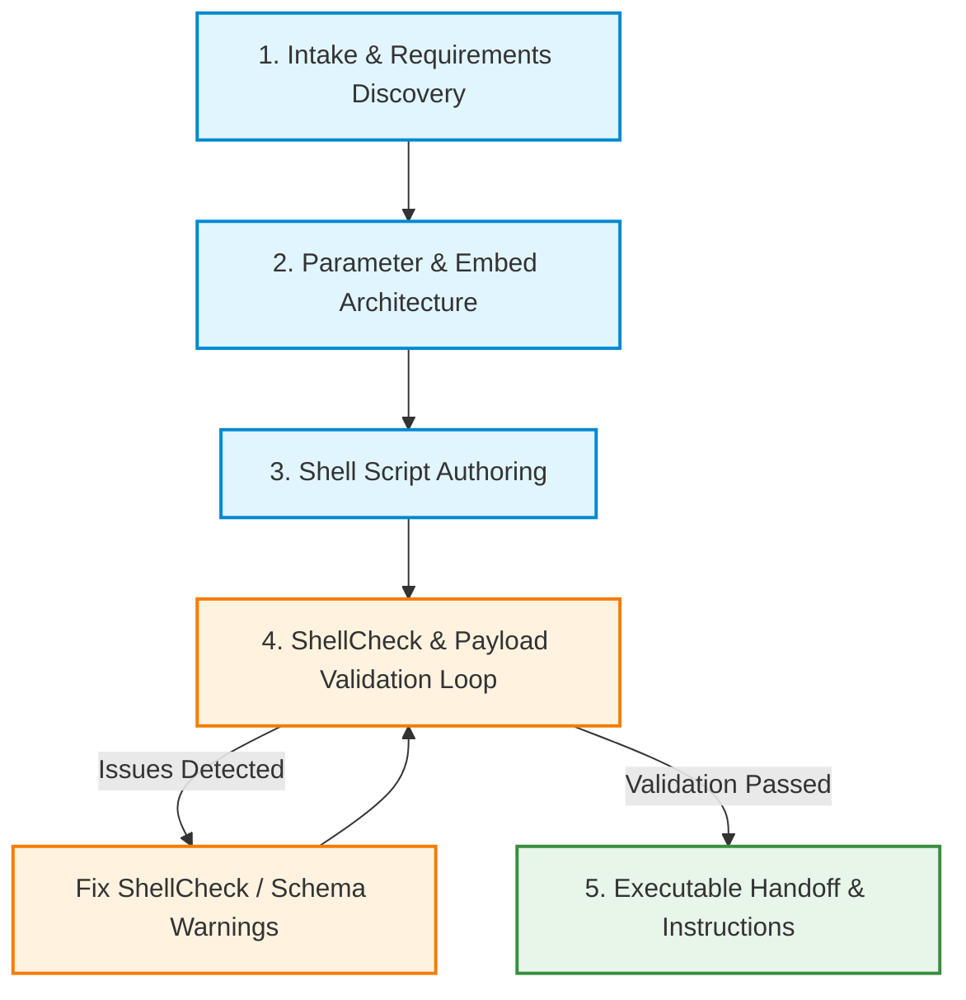

# Discord Webhook Script Writer

Interactively design, parameterize, and generate production-ready Bash scripts that deliver formatted Discord messages, rich embeds, and file attachments using `curl` and `jq`. Every script is verified with ShellCheck and validated against Discord's API schema before handoff.

---

## Bundled Tools & References

- **Supporting Scripts** *(treat `scripts/` as a black box: run `python3 scripts/validate_script.py --help` first to inspect flags rather than reading source)*:
  - `python3 scripts/validate_script.py <script.sh>`: Runs static analysis, ShellCheck linting, dry-run execution, and Discord webhook payload JSON schema validation.
  - `python3 scripts/validate_script.py <script.sh> --sample-args "--title Test --status success"`: Tests dry-run execution with sample arguments.
  - `python3 scripts/validate_script.py <script.sh> --json`: Emits validation diagnostics in structured JSON.
- **Deep-Dive References**:
  - [Discord Webhook API & curl Reference](references/discord-api-reference.md): Payload schemas, embed field constraints, decimal colors, mentions, rate limits, and multipart upload specs.
  - [Bash Scripting Standard](references/bash-scripting-standard.md): Mandatory shell safety conventions (`set -euo pipefail`, `IFS=$'\n\t'`), dual-source webhook resolution, `jq` payload construction, and retry patterns.
  - [Production Script Templates Catalog](references/script-templates.md): Index and selection guide for modular examples:
    - [CI/CD Deployment Notifier](examples/ci-cd-deploy-notify.md)
    - [Cron Server Resource Monitor](examples/cron-server-monitor.md)
    - [Automated Backup Notifier](examples/cron-backup-notify.md)
    - [File Attachment & Log Uploader](examples/file-uploader-notify.md)
    - [Generic Parameterized Alert](examples/generic-embed-alert.md)

---

## Architectural & Safety Principles

1. **Dual Webhook URL Resolution**: Never force the user into an either/or choice between CLI flags and environment variables. All generated scripts must check the CLI flag (e.g. `-w` / `--webhook-url`) first, fall back to the `DISCORD_WEBHOOK_URL` environment variable, and fail with a clear message to `>&2` if neither is provided.
2. **Safe JSON Construction via `jq`**: Never use raw bash string interpolation to construct JSON. Dynamic strings with quotes, newlines, or backslashes break naive string concatenation. Use `jq -n --arg ... --argjson ...` to guarantee valid, injection-safe JSON.
3. **ShellCheck Cleanliness**: Every generated script must pass `shellcheck -s bash` with zero errors and zero warnings.
4. **Resilient HTTP & Rate Limits**: Discord returns `204 No Content` on success. Capture HTTP status codes via `curl -sS -w "%{http_code}"` and implement backoff handling for `429 Too Many Requests` (respecting `retry_after`) and `5xx` server errors.
5. **Preview via Dry Run**: Every generated script must provide `--dry-run` to output the formatted JSON payload and webhook destination without sending network requests.

---

## Workflow: From User Request to Production Script



---

## Step-by-Step Procedure

### Step 1: Intake & Requirements Discovery

Confirm any missing parameters with the user before generating:
- **Target Use Case**: Cron job, CI/CD runner (GitHub Actions, GitLab CI), deploy hook, or manual CLI?
- **Payload & Attachments**: Plain text, rich embed, or `multipart/form-data` file upload?
- **CLI Flags & Visuals**: Dynamic arguments (`--status`, `--message`, `--repo`, `--log-file`) and status colors (Green/Red/Yellow/Blurple).
- **Mentions & Noise Control**: Role/user pings (`<@USER_ID>`, `<@&ROLE_ID>`) on failure, or silent flag (`flags: 4096`) on routine runs.

---

### Step 2: Parameter & Embed Architecture

Map requirements onto [Discord API Constraints](references/discord-api-reference.md):
- **Required Standard Flags**: `-h` / `--help`, `-w` / `--webhook-url`, and `--dry-run`.
- **Decimal Colors**: Convert hex via `$((16#RRGGBB))` — Success `5763719` (`#57F287`), Danger `15548997` (`#ED4245`), Warning `16705372` (`#FEE75C`), Info `5793266` (`#5865F2`).
- **Payload Limits**: $\le 2000$ chars content, $\le 256$ title, $\le 4096$ description, $\le 25$ fields, $\le 6000$ total embed chars.

---

### Step 3: Shell Script Authoring

Select the closest starting pattern from [Production Script Templates Catalog](references/script-templates.md) and adhere strictly to [Bash Scripting Standard](references/bash-scripting-standard.md):
1. `#!/usr/bin/env bash`, `set -euo pipefail`, `IFS=$'\n\t'`, and `mktemp -d` + `trap cleanup EXIT`.
2. `show_help()` documenting flags, defaults, `DISCORD_WEBHOOK_URL`, and examples; `while [[ $# -gt 0 ]]` flag parser.
3. Dual webhook resolution (`cli_url` -> `DISCORD_WEBHOOK_URL` -> fail to `>&2` unless `--dry-run`).
4. Build JSON exclusively via `jq -n --arg ... --argjson ...` (never raw string interpolation), send with `curl -sS -w "%{http_code}"` handling `204`/`200`, `429` (`retry_after`), and `5xx` retries, and isolate execution inside `main "$@"`.

---

### Step 4: ShellCheck & Payload Validation Loop

Before presenting the generated script to the user, execute the validation script:

```bash
# Save script to target path (e.g., ./send-discord-alert.sh)
chmod +x ./send-discord-alert.sh

# Run comprehensive validation
python3 scripts/validate_script.py ./send-discord-alert.sh --sample-args "--status success"
```

The validator checks:
1. **ShellCheck**: Zero warnings or errors.
2. **Structure**: `set -euo pipefail`, `IFS=$'\n\t'`, `main "$@"`, `-h/--help`, `--dry-run`, dual URL resolution.
3. **Execution**: Successful dry-run execution.
4. **Discord Schema**: Valid JSON, embed limits, valid decimal color range, valid ISO 8601 UTC timestamp.

If validation identifies any issues, correct the script and re-run validation until it passes with `=== Script Validation: PASSED ===`.

---

### Step 5: Executable Delivery & Instructions

Deliver the final script and provide clear instructions for:
- Making the script executable: `chmod +x <script_name>.sh`
- Setting the environment variable: `export DISCORD_WEBHOOK_URL="https://discord.com/api/webhooks/..."`
- Running ad-hoc from command line: `./<script_name>.sh --help`
- Running via Cron (`crontab -e`):
  ```cron
  # Example: Run every 15 minutes with environment variable
  DISCORD_WEBHOOK_URL=https://discord.com/api/webhooks/...
  */15 * * * * /usr/local/bin/<script_name>.sh >> /var/log/<script_name>.log 2>&1
  ```
- Running in CI/CD pipelines (e.g. GitHub Actions step or GitLab CI job).

---

## Gotchas & Technical Traps

- **SC2155 (Masking Return Codes)**: Never write `local var=$(cmd)`. If `cmd` fails, `local` swallows the exit code and `set -e` will not abort. Always declare first, then assign:
  ```bash
  local var
  var="$(cmd)"
  ```
- **Discord 204 No Content**: A standard successful webhook POST returns HTTP 204 with an empty body. Do not treat empty response bodies as failures.
- **Multipart Form Data Field**: When attaching files, the JSON payload MUST be placed in form field `payload_json`, NOT in raw body data:
  ```bash
  curl -F "payload_json=$PAYLOAD" -F "file1=@$PATH" "$URL"
  ```
- **Decimal Colors, Not Hex**: Discord API rejects hex strings like `"#5865F2"`. Colors must be 24-bit decimal integers. In Bash, convert hex with `$((16#$HEX_STR))`.
- **Date Formatting**: Webhook timestamps must be ISO 8601 UTC. Use `date -u +"%Y-%m-%dT%H:%M:%SZ"`.
- **Cron PATH and Environment**: Cron runs in a minimal environment without user shell profiles. Remind the user to specify absolute paths to `jq` and `curl` or export `PATH="/usr/local/bin:/usr/bin:/bin"` in their crontab.
