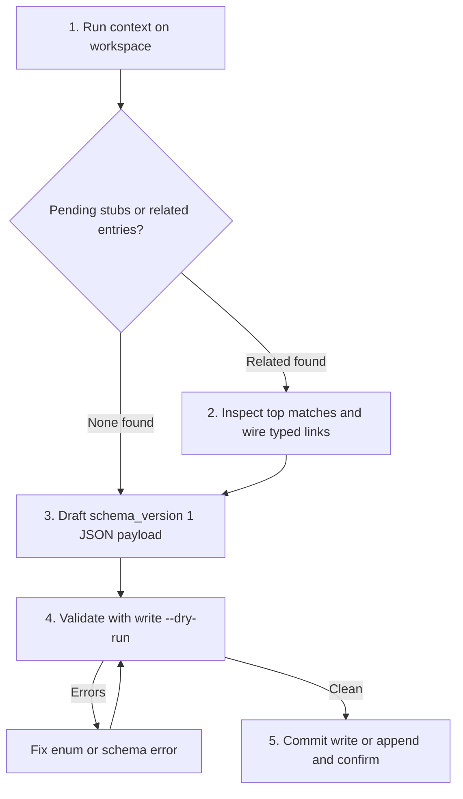

# Engineering Log (Knowledge & Thoroughness)

An epistemic flight recorder and cross-project second-brain capture engine. Distills raw technical and thinking sessions into graph-linked Markdown entries, sharded append-only JSONL ledgers (`ledgers/<stream>.jsonl`), and a deterministically compiled `INDEX.md`.

---

## Quick Reference & Bundled Tools

- **Schema & Analytics Contract**: [Schema, Vocabularies & DuckDB Recipes](references/schema.md)
- **Hooks & Optional CLIs**: [Harness Hooks, Exit Prompts & Optional Enhancers](references/harness-hooks.md)
- **CLI Engine (`scripts/eng_log.py`)** *(treat as a black box: run `python3 scripts/eng_log.py --help` and `<subcommand> --help` first rather than reading source)*:
  - `python3 scripts/eng_log.py init [--dir DIR]`
  - `python3 scripts/eng_log.py context [--cwd PATH] [--query TEXT] [--tech CSV] [--concepts CSV]`
  - `python3 scripts/eng_log.py write --cwd . [--input FILE|-] [--dry-run] [--verbose]`
  - `python3 scripts/eng_log.py append --id <ENTRY_ID> [--input FILE|-] [--dry-run]`
  - `python3 scripts/eng_log.py graph --id <ENTRY_ID> [--depth 2] [--format markdown]`
  - `python3 scripts/eng_log.py rebuild-index [--dir DIR]`
  - `python3 scripts/eng_log.py query [--project X] [--tech X] [--text X] [--exclude-superseded] [--format markdown]`
  - `python3 scripts/eng_log.py stats [--project X] [--since YYYY-MM-DD] [--format markdown]`
  - `python3 scripts/eng_log.py validate [--dir DIR]`

*(Default store: `$ENGINEERING_LOG_DIR` or `~/engineering-log/`. Pass `--dir <path>` to target a repo-local or custom store.)*

---

## Epistemic Principles

1. **Anti-Smoothing (Capture the Delta, Not a Victory Story)**:
   Never launder a chaotic session into "we diagnosed X and fixed Y." Explicitly record `belief_revisions` (`assumed` → `contradicted_by` → `revised_model`) and `dead_ends` (exact `error_signature` + `why_failed`).
2. **Never Fabricate Metrics**:
   Let `eng_log.py context` harvest git/semantic ground truth (`files_changed`, `sem` entities, `inspect` risk tiers). If a metric cannot be observed (e.g., non-git workspace or uncalibrated rating), emit `null` or omit — never guess.
3. **Measure the Terrain and Loop, Never the Person**:
   Use `telemetry` (`agent_impact`, `agent_failure_modes`, `unsticking_catalyst`) to evaluate codebases, tools, models, and workflows — not human productivity.
4. **Non-Code Sessions Are First-Class**:
   Architecture brainstorms, doc reviews, and design spikes without git work cleanly (`session_shape: brainstorm`, `git: null`, `code_semantics: null`).

---

## Capture Workflow (`/engineering-log`)



### Step 1: Harvest Context & Related Nodes
Run `context` while conversation memory is hot:
```bash
python3 scripts/eng_log.py context --cwd . \
  --query "<key topic or error phrase>" \
  --tech "<comma-separated stack>" \
  --concepts "<comma-separated concepts>"
```
Inspect the returned JSON for:
- `git` and `code_semantics` (`sem` entities / `inspect` blast radius, automatically `null` outside git or when CLIs are absent)
- `related_entries` (top prior entries ranked by project/tech/concept/term overlap)
- `pending_stubs` (any unlogged sessions bookmarked by `SessionEnd` hooks)

### Step 2: Wire Typed Graph Edges & Epistemic Half-Life
Avoid flat tag hairballs. Connect to relevant `related_entries` using `links`:
- `builds_on`, `supersedes` (marks older entry outdated in `INDEX.md`), `contradicts`, `same_root_cause`, `spawns`.
- Assign `confidence` (`verified` | `observed` | `hypothesis`) and `shelf_life` (`evergreen` | `version-bound` | `ephemeral`) accurately so future recall does not surface stale hacks as timeless truth.

### Step 3: Draft Payload & Dry-Run Validate
Construct the JSON payload (see [Schema Reference](references/schema.md) for all enums and optional fields). Pass `--cwd .` so `write` deterministically auto-harvests `git`, `code_semantics`, and `actor` defaults—focus the JSON strictly on epistemic deltas, telemetry, concepts, and typed graph links. Always validate via `--dry-run` before committing:
```bash
python3 scripts/eng_log.py write --cwd . --dry-run --input - <<'EOF'
{ ... }
EOF
```

### Step 4: Commit & Confirm
Re-run without `--dry-run` (or use `append --id <ENTRY_ID>` when adding milestones to an existing entry). Report the confirmation block below.

---

## Secondary Modes

- **Follow-up Addendum (`append`)**: When adding late verification, closing threads (`closed_threads`), or graduating rules via `/learn` / `.agents/rules/` (`promoted_rules`), run `python3 scripts/eng_log.py append --id <ENTRY_ID> --input -` rather than mutating the original `.md` by hand.
- **Graph Traversal (`graph`)**: Expand 1–2 hops of incoming and outgoing edges around an entry before batch-reading linked Markdown files:
  ```bash
  python3 scripts/eng_log.py graph --id <ENTRY_ID> --depth 2 --format markdown
  ```
- **Pre-Flight Recall (`query`)**: Surface active learnings before starting work in a repo or stack:
  ```bash
  python3 scripts/eng_log.py query --project <slug> --exclude-superseded --format markdown
  ```
- **Cross-Project Telemetry & Graph Insights (`stats`)**: Summarize outcome rates, mean friction/value by model/harness, top `agent_failure_modes`, `unsticking_catalyst` impact, Déjà Vu root-cause clusters, and DuckDB one-liners:
  ```bash
  python3 scripts/eng_log.py stats --format markdown
  ```
- **Pending Session Catch-Up**: Run `eng_log.py hook --mode pending-list` and distill worthwhile bookmarked sessions, or delete dismissed `.json` stubs in `pending/`.

---

## Execution & Quota Posture

- **Manual Boundary Trigger**: Invoke via `/engineering-log` at session or milestone boundaries rather than ambient routing; pair with the zero-token `PostInvocation` nudge and `SessionEnd` bookmarking in [Harness Hooks](references/harness-hooks.md).
- **Model & Effort Tier**: Default to `fast` / `medium` (`gemini-4-hydrogen-medium`)—deterministic `--cwd` harvesting and strict validation handle mechanical fields cleanly. Escalate to `standard` / `medium` (`gemini-4-neon-medium`) for multi-hour, high-friction (`>= 4`) marathons needing deep belief-revision synthesis.

---

## Gotchas & Edge Cases

- **Never hand-edit `INDEX.md`**: It is 100% deterministically compiled from `ledgers/**/*.jsonl`. Run `rebuild-index` if needed.
- **Never write directly to `ledgers/*.jsonl` or `entries/*.md`**: Bypassing `eng_log.py` skips schema checks, secret redaction, relative link resolution, and atomic shard appends.
- **Sharded ledgers prevent merge conflicts**: Each writer appends only to `ledgers/<user>-<machine>.jsonl` (override with `--stream`). Never merge two machines by editing JSONL lines manually.
- **Portable standard links only**: Use standard relative Markdown links (`../../YYYY/MM/file.md` between entries, `entries/YYYY/MM/file.md` from `INDEX.md`) — never Obsidian-only `[[wikilinks]]`.
- **Keep `research-journaler` separate**: Use `research-journaler` for repo-local prospective inquiry logs (`prompts.json`, `sources/`, `outputs/`); use `engineering-log` for retrospective cross-project learning and telemetry.
- **Secret redaction check**: Even though `eng_log.py` scrubs tokens, bearer headers, PEM keys, and credentialed URLs automatically, never paste raw `.env` dumps into payloads; inspect `redactions_applied` if > 0.
- **DuckDB CLI in non-TTY shells**: Pass `duckdb -dark-mode` when running analytics recipes from scripts or agent tools to avoid terminal color-probe delays.
- **Safe dry-run discipline**: Always invoke `--dir /tmp/...` (never `~/engineering-log`) when testing or evaluating changes to the skill itself.

---

## Output Format (Session Confirmation)

```markdown
Logged session `<entry_id>` (`<project>`)
- **File:** `<store_dir>/<file_path>` (ledger: `<ledger_path>`)
- **Highlight:** `<one-line summary>`
- **Epistemic Deltas:** <N> belief revision(s), <N> dead end(s), <N> rule candidate(s)
- **Graph Links:** <linked target IDs + rel, or "none">
- **Telemetry:** shape=`<session_shape>`, outcome=`<outcome>`, friction=`<1-5|n/a>`, value=`<1-5|n/a>`, impact=`<agent_impact>`
- **Redactions:** `<redactions_applied>` secret(s) scrubbed
```
