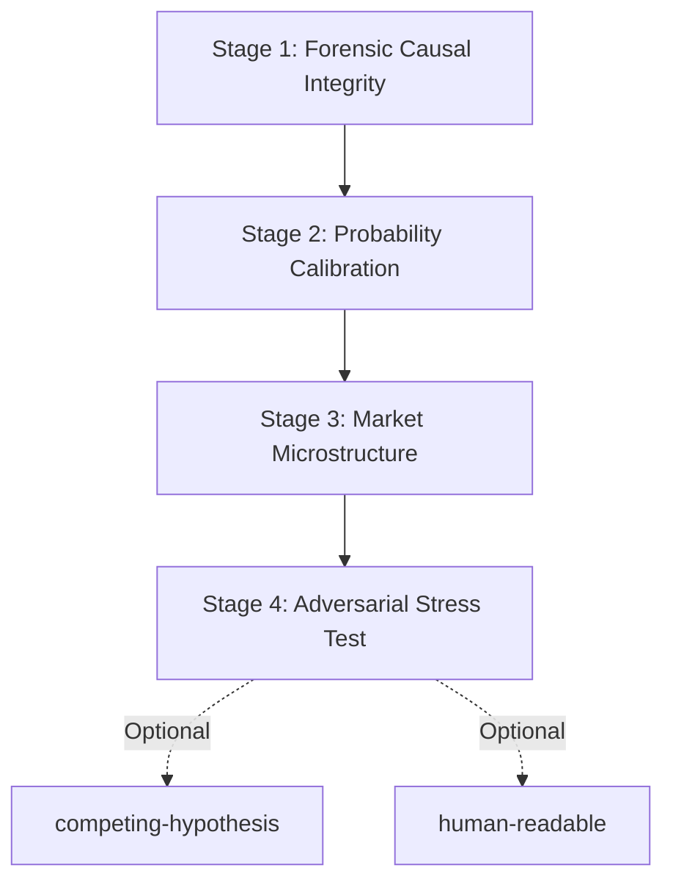

# Quantitative Edge Auditor (`quant-edge-auditor`)

An enterprise-grade quantitative auditing, statistical verification, and adversarial stress-testing harness for sports prediction and betting models. Replaces superficial LLM conversational inspection with deterministic mathematical verification.

---

## Quick Reference & Bundled Tools

- **Core References**:
  - [Market De-vigging Methodologies (Shin, Power, Log-Odds)](references/devigging_methodologies.md)
  - [Multiple Testing Corrections & Deflated Sharpe](references/multiple_testing_limits.md)
  - [Temporal Purging, Embargoing & As-Of Joins](references/temporal_purging.md)
  - [Quantitative Rationale & External Oracles](references/rationale-and-oracles.md)
- **Bundled Automation Scripts** *(treat `scripts/` as black boxes: run `python3 scripts/<tool>.py --help` first to inspect flags rather than reading source)*:
  - `python3 scripts/asof_leakage_verifier.py <dataset>`: Forensic bitemporal join, timestamp lookahead, and retroactive closing-odds validator.
  - `python3 scripts/brier_murphy_decomp.py <dataset>`: Decomposes Brier score into Reliability, Resolution, and Uncertainty.
  - `python3 scripts/devig_market.py <odds...>`: Shin (insider $z$ parameter), Power, Log-Odds, and Proportional market devigging.
  - `python3 scripts/bootstrap_stress_test.py <dataset>`: Politis-Romano geometric stationary block bootstrap (reproducible via `--seed`), CLV $t$-stat, and skewness/kurtosis-adjusted Deflated Sharpe Ratio (DSR).
  - `python3 scripts/run.py <dataset>`: Master 4-stage audit runner synthesizing the full scorecard and propagating failure exit codes.

---

## Subagent & Skill Composition



- **Execution Tiers**: Delegate script-heavy numerical audits (Stages 1–3) to fast/standard workers and reserve deep reasoning for Stage 4 adversarial falsification, or run `scripts/run.py` end-to-end in a single turn.
- **Optional Skill Reuse**: Pair Stage 4 with `competing-hypothesis` to pit genuine edge against data snooping/latency, and optionally apply `human-readable` to executive audit summaries.

---

## 4-Stage Operational Audit Protocol

Execute stages strictly in order; **Stage 1 leakage rejects the model immediately** regardless of downstream Brier or ROI metrics.

### Stage 1: Forensic Causal Integrity & Lineage (Hard Gate)
Run `scripts/asof_leakage_verifier.py` first to verify:
- $T_{\text{knowledge}} \le T_{\text{decision}} < T_{\text{event}}$ holds across 100% of rows (`causal_integrity_rate == 100%`).
- `placed_odds` are not retroactively cloned from `closing_odds` (`retroactive_odds_leakage == false`).
- Zero post-kickoff stats (`final_score`, `boxscore`, `actual_yards`) appear in feature headers.

```bash
python3 scripts/asof_leakage_verifier.py path/to/dataset.csv
```

### Stage 2: Probability Calibration & Discrimination
Run `scripts/brier_murphy_decomp.py` on out-of-sample predictions and record Murphy's Brier Decomposition plus equal-frequency quantile ECE:
- **Reliability Penalty**: Must approach $0.0$ (high penalty signals overconfidence in extreme probabilities).
- **Resolution**: Must be strictly positive (measures separation of winners from losers).

```bash
python3 scripts/brier_murphy_decomp.py path/to/dataset.csv --strategy quantile --bins 10
```

### Stage 3: Market Microstructure & CLV Benchmark
Run `scripts/devig_market.py` using **Shin's Method** to strip bookmaker overround and recover fair probabilities, then benchmark CLV against sharp closers (Pinnacle/Circa) accounting for commissions and execution slippage:
$$\text{CLV} = \frac{O_{\text{placed}}}{O_{\text{benchmark\_shin\_fair}}} - 1$$

```bash
python3 scripts/devig_market.py -110 -110 --method shin
```

### Stage 4: Adversarial Stress Testing & Falsification
Estimate discarded trial count ($N_{\text{trials}}$) across all tested features/rules and run `scripts/bootstrap_stress_test.py --trials <N>` (pass `--seed` for reproducible bootstrap/permutation runs):
- **CLV Significance**: Require $t\text{-stat} \ge 3.0$ over independent games.
- **Deflated Sharpe Ratio (DSR)**: Require $\text{DSR} > 0.95$; otherwise reject as data snooping.
- **Null Permutation & Drawdown**: Require scrambled-target $p\text{-value} < 0.01$ and inspect 95% stationary block bootstrap drawdown.

```bash
python3 scripts/bootstrap_stress_test.py path/to/dataset.csv --trials 25 --sims 1000 --seed 42
```

---

## Domain Gotchas

1. **The P&L Mirage**:
   Never accept positive ROI as evidence of edge in sample sizes under 1,000 bets. Without a positive CLV $t$-statistic against sharp books ($t \ge 3.0$), positive ROI is pure variance.
2. **The Favorite-Longshot Bias Trap**:
   Never use naive proportional devigging on markets with longshots ($> +300$ or $< 1.30$). Sportsbooks load excess margin onto longshots. Always use **Shin's method** or the **Power method**.
3. **The Unreported Graveyard**:
   If a user presents a backtest without stating how many rules or feature combinations were tested, assume $N_{\text{trials}} \ge 20$ by default and calculate the Deflated Sharpe haircut accordingly.
4. **Correlated Same-Slate Exposure**:
   Wagers on the same game (e.g. QB passing yards, WR receiving yards, and game Under) cannot be treated as independent Bernoulli trials. Stationary block bootstrapping must be used to preserve covariance.
5. **Screen Odds vs. Fillable Odds**:
   Soft sportsbooks limit winning players within dozens of bets. An edge that only exists at soft books with \$50 maximum stakes cannot be scaled into a viable betting portfolio.

---

## Output Format: The Quantitative Audit Scorecard

Every audit concludes with a standardized Markdown scorecard:

```markdown
# Quantitative Edge Audit Scorecard

**Target Model/Dataset**: `[Filename / Commit Hash]`
**Prior Discarded Trials ($N_{\text{trials}}$)**: `[N]`
**Sample Size**: `[N]` prospective bets

### 1. Forensic Causal Integrity
- **Causal Integrity Rate**: `[100% | Failed]`
- **Leakage Status**: `[Clean | Lookahead Detected in N rows]`

### 2. Statistical Calibration & Resolution
- **Brier Score**: `[X.XXXX]` | **Log Loss**: `[X.XXXX]`
- **Reliability Penalty**: `[X.XXXX]` (0 = perfect calibration)
- **Resolution Discrimination**: `[X.XXXX]` (ability to sort outcomes)
- **Quantile ECE**: `[X.XX%]`

### 3. Market Microstructure & CLV
- **Mean CLV vs. Sharp Benchmark**: `[+X.XX%]`
- **CLV $t$-statistic**: `[X.XX]` (Hurdle >= 3.0)
- **Shin Informed Capital Parameter ($z$)**: `[X.XXXX]`

### 4. Adversarial Falsification & Stress Test
- **Observed ROI**: `[+X.XX%]` | **Max Drawdown**: `[X.X]` units
- **95% Bootstrap Worst-Case Drawdown**: `[X.X]` units
- **Deflated Sharpe Ratio (DSR)**: `[0.XXXX]` (Hurdle > 0.95)
- **Null Permutation $p$-value**: `[0.XXXX]` (Hurdle < 0.01)

## Final Audit Verdict: [DURABLE_EDGE | SUSPECT_OVERFITTING | REJECTED_LEAKAGE]
```
