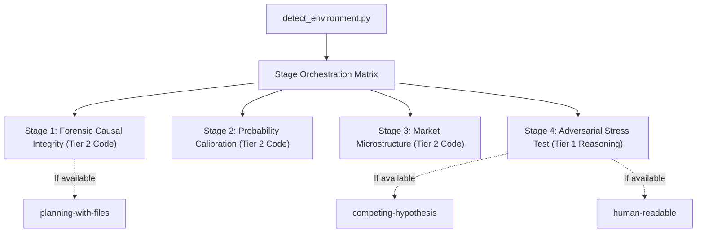

# Quantitative Edge Auditor (`quant-edge-auditor`)

An enterprise-grade quantitative auditing, statistical verification, and adversarial stress-testing harness for sports prediction and betting models. Replaces superficial LLM conversational inspection with deterministic mathematical verification.

---

## Quick Reference & Bundled Tools

- **Core References**:
  - [Market De-vigging Methodologies (Shin, Power, Log-Odds)](references/devigging_methodologies.md)
  - [Multiple Testing Corrections & Deflated Sharpe](references/multiple_testing_limits.md)
  - [Temporal Purging, Embargoing & As-Of Joins](references/temporal_purging.md)
  - [Human-Readable Skill Rationale & Deep Architecture](README.md)
- **Bundled Automation Scripts**:
  - `python3 quant-edge-auditor/scripts/detect_environment.py`: Discovers runtime models and installed skills; outputs dynamic subagent tier assignments.
  - `python3 quant-edge-auditor/scripts/asof_leakage_verifier.py <dataset>`: Forensic bitemporal join and timestamp lookahead validator.
  - `python3 quant-edge-auditor/scripts/brier_murphy_decomp.py <dataset>`: Decomposes Brier score into Reliability, Resolution, and Uncertainty.
  - `python3 quant-edge-auditor/scripts/devig_market.py <odds...>`: Shin (insider $z$ parameter), Power, and Proportional market devigging.
  - `python3 quant-edge-auditor/scripts/bootstrap_stress_test.py <dataset>`: Stationary block bootstrap, CLV $t$-stat, and Deflated Sharpe Ratio (DSR).
  - `python3 quant-edge-auditor/scripts/run.py <dataset>`: Master 4-stage audit runner synthesizing the full scorecard.

---

## Dynamic Runtime Adaptation

Before delegating audit sub-tasks to subagents, the orchestrating agent MUST invoke the environment discovery utility:

```bash
python3 quant-edge-auditor/scripts/detect_environment.py --summary
```

### Delegation Strategy by Tier & Skill Discovery



- **Tier 2 Models (`flash`, `medium`, `inherit`)**: Assigned to Stages 1, 2, and 3 where execution of mathematical scripts and JSON validation dominates.
- **Tier 1 Models (`pro`, `deepthink`, `o1`)**: Assigned to Stage 4 (Adversarial Red-Teaming) to formulate rival hypotheses for why an apparent edge may be a statistical artifact.
- **Skill Reuse**:
  - If `competing-hypothesis` is detected, invoke it during Stage 4 to systematically pit genuine edge against data snooping, market latency, and luck.
  - If `planning-with-files` is detected, write `task_plan.md` to track multi-stage progress across large datasets.
  - If `human-readable` is detected, use it to polish final audit scorecards.

---

## 4-Stage Operational Audit Protocol

When auditing a sports prediction model or historical betting record, execute the following 4-stage checklist:

### Stage 1: Forensic Causal Integrity & Lineage
- [ ] Run `scripts/asof_leakage_verifier.py` on the input dataset.
- [ ] Confirm $T_{\text{knowledge}} \le T_{\text{decision}} < T_{\text{event}}$ holds on 100% of rows.
- [ ] Verify that placed odds are not retroactively set to closing odds.
- [ ] Screen feature headers for post-kickoff stats (`final_score`, `boxscore`, `actual_yards`).

```bash
python3 quant-edge-auditor/scripts/asof_leakage_verifier.py path/to/dataset.csv
```

### Stage 2: Probability Calibration & Discrimination
- [ ] Run `scripts/brier_murphy_decomp.py` on out-of-sample predictions.
- [ ] Record the Murphy Brier Decomposition:
  - **Reliability Penalty**: Must approach $0.0$. High reliability penalty indicates overconfidence in extreme probabilities.
  - **Resolution**: Must be strictly positive. Measures ability to separate winners from losers.
- [ ] Evaluate Expected Calibration Error (ECE) using equal-frequency quantile bins.

```bash
python3 quant-edge-auditor/scripts/brier_murphy_decomp.py path/to/dataset.csv --strategy quantile --bins 10
```

### Stage 3: Market Microstructure & CLV Benchmark
- [ ] For quoted odds, run `scripts/devig_market.py` using **Shin's Method** to remove bookmaker overround and recover true fair probabilities.
- [ ] Compute Closing Line Value (CLV) against sharp benchmark books (Pinnacle/Circa):
  $$\text{CLV} = \frac{O_{\text{placed}}}{O_{\text{benchmark\_shin\_fair}}} - 1$$
- [ ] Measure account degradation and realistic execution costs (margin, commissions, exchange fees).

```bash
python3 quant-edge-auditor/scripts/devig_market.py -110 -110 --method shin
```

### Stage 4: Adversarial Stress Testing & Falsification
- [ ] Determine the total number of discarded model versions, qualification rules, or feature configurations ($N_{\text{trials}}$).
- [ ] Run `scripts/bootstrap_stress_test.py` with `--trials <N>`:
  - **CLV Significance**: Verify $t\text{-stat} \ge 3.0$ over independent games.
  - **Deflated Sharpe Ratio (DSR)**: Confirm $\text{DSR} > 0.95$. If $\text{DSR} \le 0.95$, reject the edge as a product of data mining.
  - **Null Permutation Test**: Verify scrambled target outcome $p\text{-value} < 0.01$.
  - **Stationary Block Bootstrap**: Inspect 95% worst-case drawdown.

```bash
python3 quant-edge-auditor/scripts/bootstrap_stress_test.py path/to/dataset.csv --trials 25 --sims 1000
```

---

## Domain Gotchas

1. **The P&L Mirage**:
   Never accept positive ROI as evidence of edge in sample sizes under 1,000 bets. Without a positive CLV $t$-statistic against sharp books ($t \ge 3.0$), positive ROI is pure variance.
2. **The Favorite-Longshot Bias Trap**:
   Never use naive proportional devigging on markets with longshots ($> +300$ or $< 1.30$). Sportsbooks load excess margin onto longshots. Always use **Shin's method** or the **Power method**.
3. **The Unreported Graveyard**:
   If a user presents a backtest without stating how many rules or feature combinations were tested, assume $N_{\text{trials}} \ge 20$ by default and calculate the Deflated Sharpe haircut accordingly.
4. **Correlated Same-Slate Exposure**:
   Wagers on the same game (e.g. QB passing yards, WR receiving yards, and game Under) cannot be treated as independent Bernoulli trials. Stationary block bootstrapping must be used to preserve covariance.
5. **Screen Odds vs. Fillable Odds**:
   Soft sportsbooks limit winning players within dozens of bets. An edge that only exists at soft books with \$50 maximum stakes cannot be scaled into a viable betting portfolio.

---

## Output Format: The Quantitative Audit Scorecard

Every audit concludes with a standardized Markdown scorecard:

```markdown
# Quantitative Edge Audit Scorecard

**Target Model/Dataset**: `[Filename / Commit Hash]`
**Prior Discarded Trials ($N_{\text{trials}}$)**: `[N]`
**Sample Size**: `[N]` prospective bets

### 1. Forensic Causal Integrity
- **Causal Integrity Rate**: `[100% | Failed]`
- **Leakage Status**: `[Clean | Lookahead Detected in N rows]`

### 2. Statistical Calibration & Resolution
- **Brier Score**: `[X.XXXX]` | **Log Loss**: `[X.XXXX]`
- **Reliability Penalty**: `[X.XXXX]` (0 = perfect calibration)
- **Resolution Discrimination**: `[X.XXXX]` (ability to sort outcomes)
- **Quantile ECE**: `[X.XX%]`

### 3. Market Microstructure & CLV
- **Mean CLV vs. Sharp Benchmark**: `[+X.XX%]`
- **CLV $t$-statistic**: `[X.XX]` (Hurdle >= 3.0)
- **Shin Informed Capital Parameter ($z$)**: `[X.XXXX]`

### 4. Adversarial Falsification & Stress Test
- **Observed ROI**: `[+X.XX%]` | **Max Drawdown**: `[X.X]` units
- **95% Bootstrap Worst-Case Drawdown**: `[X.X]` units
- **Deflated Sharpe Ratio (DSR)**: `[0.XXXX]` (Hurdle > 0.95)
- **Null Permutation $p$-value**: `[0.XXXX]` (Hurdle < 0.01)

## Final Audit Verdict: [DURABLE_EDGE | SUSPECT_OVERFITTING | REJECTED_LEAKAGE]
```
